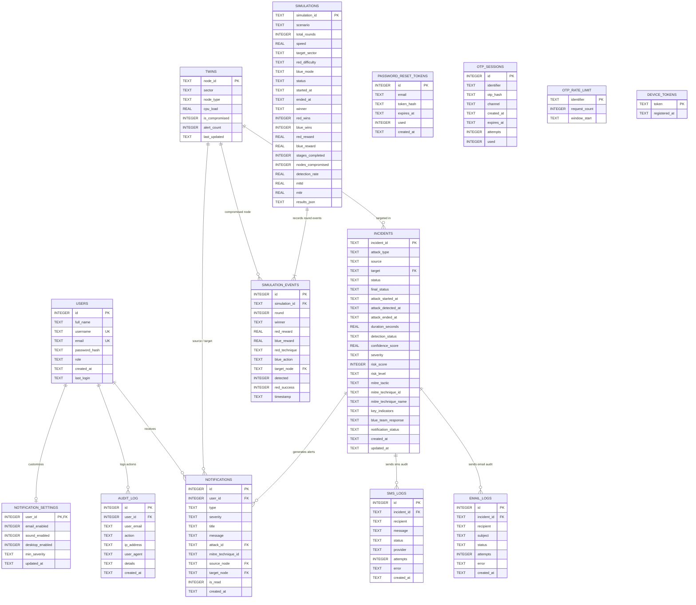

# ACDSF (Autonomous Cyber Defense Simulation Framework) — Database ER Diagram

This document outlines the entity relationships, relational schema, and domain architecture for the ACDSF backend database (`digital_twin.db`).

---

## 1. High-Level Architecture Overview

```
                      +-----------------------------+
                      |            USERS            |
                      +-----------------------------+
                        |            |            |
                (1:N)   |      (1:1) |      (1:N) |
                        v            v            v
             +-------------+  +---------------+  +---------------+
             |  AUDIT_LOG  |  | NOTIF_SETTINGS|  | NOTIFICATIONS |
             +-------------+  +---------------+  +---------------+
                                                        ^
                                                        | (1:N)
+-----------------------+              (1:N)            |
|         TWINS         | <---------------------+---------------+
| (Digital Twin Nodes)  |                       |   INCIDENTS   |
+-----------------------+ <-------+             | (Red vs Blue) |
            ^                     |             +---------------+
            |                     | (1:N)               |
            | (1:N)               |             (1:N)   +----------+ (1:N)
            |                     |                     v          v
+-----------------------+         |               +---------+ +---------+
|   SIMULATION_EVENTS   | --------+               |EMAIL_LOG| | SMS_LOG |
+-----------------------+                         +---------+ +---------+
            ^
            | (N:1)
+-----------------------+
|      SIMULATIONS      |
|  (Multi-Agent Arena)  |
+-----------------------+
```

---

## 2. Interactive Mermaid ER Diagram



---

## 3. Subsystem Extensions

### SOAR Playbooks (`soar_cases.db`)
- **`CASES`** (`id` PK, `title`, `description`, `severity`, `status`, `target`, `created_at`, `resolved_at`)
- **`CASE_ACTIONS`** (`id` PK, `case_id` FK -> `cases.id`, `action`, `result`, `timestamp`)

### Threat Intelligence (`threat_intel.db`)
- **`IOCS`** (`id` PK, `source`, `ioc_type`, `value`, `threat_tag`, `first_seen`, `fetched_at`)
