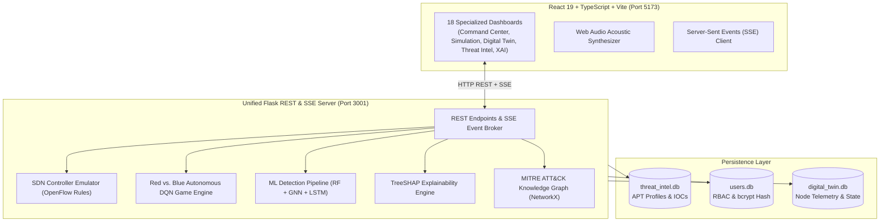

# ACDSF — AI-Powered Cyber Defence Simulation Framework

[](LICENSE)
[](https://python.org)
[](https://react.dev)
[](https://www.typescriptlang.org)
[](https://vitejs.dev)
[](https://tailwindcss.com)
[](docker-compose.yml)

> **ACDSF** is a sovereign, enterprise-grade Cyber Warfare Simulator and SecOps Command Platform. It models autonomous adversarial cyber campaigns against a **43-node National Infrastructure Digital Twin** across 6 critical sectors using **Deep Q-Networks (DQN)**, real-time **Software-Defined Networking (SDN)** containment, **MITRE ATT&CK** threat intelligence, and **Explainable AI (TreeSHAP)** telemetry.

---

## 🏛️ System Architecture



---

## 🌐 43-Node Sovereign Digital Twin Topology

The digital twin models a resilient sovereign mesh connecting **6 critical national infrastructure sectors** to a central **National Backbone Router (`NBR-01`)**:

```
                         [ NBR-01 ]
             (National Backbone Router - Core 10G)
          /         /         |         \         \         \
   [FINANCE]   [TELECOM]   [ENERGY]    [GOVT]   [TRANSPORT]  [WATER]
```

Each of the 6 sectors contains an identical 7-node subnetwork hierarchy ($6 \times 7 = 42 + 1\text{ backbone} = \mathbf{43\text{ nodes}}$):

1. `<SEC>-RTR`: Ingress Boundary Router (BGP Peering)
2. `<SEC>-FW`: Next-Gen Perimeter Firewall (Stateful Packet Inspection)
3. `<SEC>-SW`: Core Distribution Switch (SDN Microsegmentation Hook)
4. `<SEC>-SRV1`: Primary Application Server (SCADA Core, SWIFT Gateway)
5. `<SEC>-SRV2`: High-Availability Database Server (Encrypted Datastore)
6. `<SEC>-PC1`: User Land Workstation (Initial Access Entrypoint)
7. `<SEC>-PC2`: Privileged Admin Terminal (Holds SSH/RDP Credentials)

---

## ⚔️ Autonomous AI Warfare: Red vs. Blue DQN

ACDSF implements a competitive multi-agent Markov Decision Process (MDP):

### 🔴 Red Team Adversary DQN
- **Objective**: Maximize compromised high-value assets while evading detection.
- **Action Space**: Full **MITRE ATT&CK** kill-chain execution:
  - `Reconnaissance` (T1595 - Port scanning & service enumeration)
  - `Initial Access` (T1566 - Spearphishing, T1190 - Exploit public application)
  - `Execution & Privilege Escalation` (T1059 - Command line shell, T1068 - Kernel exploit)
  - `Lateral Movement` (T1021 - SMB/RDP pivot through core switch)
  - `Impact & Exfiltration` (T1486 - Ransomware encryption, T1041 - C2 exfiltration)

### 🔵 Blue Team Sovereign SOAR DQN
- **Objective**: Minimize Mean Time to Detect (MTTD), Mean Time to Respond (MTTR), and protect server assets.
- **Detection Stack**: Hybrid Random Forest + Graph Neural Network (GNN) scoring raw packet telemetry.
- **Action Space**: Real-time Software-Defined Network microsegmentation:
  - `SDN Flow Quarantine`: Injects OpenFlow flow table drop rules isolating malicious nodes.
  - `Traffic Rate Limiting`: Dynamic bandwidth throttling to suppress DDoS and lateral propagation.
  - `Node Restoration`: Clean image reversion and credential rotation.
  - `Emergency Perimeter Lockdown`: Instant air-gapping of critical sector gateways.

---

## 🧠 Explainable AI (XAI) with TreeSHAP

Every detection decision is fully transparent. The **XAI Machine Reasoning** dashboard decomposes classification predictions into individual feature contributions using TreeSHAP waterfall charts:

- `src_bytes` & `dst_bytes`: Payload volume attributions flagging exfiltration.
- `count` & `srv_count`: Connection frequency attributions flagging port scans and brute-force attempts.
- `serror_rate`: SYN error frequencies flagging stealth half-open scanning.

---

## 🖥️ Complete Dashboard Breakdown

| # | Route | Dashboard Name | Role / Purpose |
|---|---|---|---|
| 1 | `/auth` | **Authentication Gateway** | Sovereign clearance login & registration with password strength audit |
| 2 | `/app/command-center` | **Command Center** | Executive SOC overview: DEFCON banner, 8 KPI cards, sector situation map |
| 3 | `/app/simulation` | **Live AI Simulation** | Interactive battle arena: configure scenario, speed, and rounds |
| 4 | `/app/battlefield` | **Cyber Battlefield** | Full-screen tactical SVG radar HUD with active laser attack beams |
| 5 | `/app/digital-twin` | **Digital Twin SDN** | 43-node ReactFlow mesh with live telemetry and one-click SDN quarantine |
| 6 | `/app/threat-intelligence` | **Threat Intel Feed** | MITRE ATT&CK knowledge graph, APT dossiers, and searchable IOC table |
| 7 | `/app/topology` | **Network Topology** | Intra-sector subnets, routing tables, latency, and link bandwidth |
| 8 | `/app/ai-defence` | **Autonomous AI Shield** | Automated SOAR playbooks (Ransomware killswitch, C2 DNS sinkhole) |
| 9 | `/app/xai-insights` | **XAI Machine Reasoning** | TreeSHAP feature attribution waterfall plots on packet telemetry |
| 10 | `/app/incidents` | **Incident Triage & Radar** | Multi-filter incident ledger with forensic drawer and resolution actions |
| 11 | `/app/attack-report` | **Attack Report & Export** | Forensic post-incident debrief with branded **PDF & JSON Export** |
| 12 | `/app/analytics` | **Telemetry Analytics** | Multi-day threat density charts, sector heatmaps, and MTTR vs. MTTD |
| 13 | `/app/admin` | **Admin Sovereignty** | Service mesh health matrix and **Global Emergency Network Lockdown** |
| 14 | `/app/users` | **IAM & User Registry** | Operator provisioning, role elevation, and audit logs |
| 15 | `/app/profile` | **Operator Dossier** | Account credentials, password change, and acoustic siren settings |
| 16 | `/app/analyst` | **Analyst Terminal** | Dual-pane alert investigation desk with live AI recommendations |
| 17 | `/app/red-team` | **Red Team Hub** | Offensive campaign theatre monitoring killchain progress & exploit yield |
| 18 | `/app/blue-team` | **Blue Team Defense** | Tactical containment floor with one-click IP blocking and node isolation |
| 19 | `/app/settings` | **System Settings** | Stream intervals, dual-theme toggle, and audio volume calibration |

---

## 🎨 Dual Sovereign Theme Engine

ACDSF features two high-contrast themes:

1. **Dark Cyber Void (Default)**: Deep `#030712` background, holographic glassmorphism, glowing cyan (`#06b6d4`) and magenta (`#ef4444`) accents, and CRT scanline effects.
2. **Sovereign Light Pink & Yellow Edition**: Radiant pastel pink (`#FBCFE8` / `#FDF2F8`) paired with soft warm light yellow (`#FEF3C7` / `#FEF9C3`) and rose-pink borders (`#F472B6`), designed for maximum legibility in report mode.

---

## 🚀 Quick Start Guide

### Prerequisites
- **Python**: 3.10 or higher
- **Node.js**: 18.x or higher (`npm` included)
- **Git**

### 1. Clone the Repository
```bash
git clone https://github.com/thrishar12/acdsf2026.git
cd acdsf2026
```

### 2. Start Backend (Flask)
```bash
# Open a new terminal
cd acdsf-backend

# (Optional) Create virtual environment
python -m venv venv
venv\Scripts\activate       # On Windows
# source venv/bin/activate  # On Linux / macOS

# Install dependencies
pip install -r requirements.txt

# Run backend
python app.py
```
*Backend runs on: **`http://127.0.0.1:3001`***  
*Health Check: `curl http://127.0.0.1:3001/health`*

### 3. Start Frontend (React + Vite)
```bash
# Open another terminal
cd acdsf-frontend

# Install dependencies
npm install

# Run development server
npm run dev
```
*Frontend runs on: **`http://localhost:5173`***

---

## 🐳 Running with Docker

You can run the entire ACDSF stack with a single command using Docker Compose:

```bash
docker-compose up --build
```

- **Frontend**: `http://localhost:5173`
- **Backend API**: `http://localhost:3001`

---

## 📁 Repository Structure

```text
ACDSF/
├── acdsf-backend/               # Python Flask unified backend
│   ├── ai/                      # Detection pipeline (GNN, LSTM, RF)
│   ├── api/                     # REST routes (orchestration, RL, ML, attacks)
│   ├── digital_twin/            # SDN controller emulator and topology state
│   ├── orchestration/           # Autonomous scenario engines (ransomware, DDoS)
│   ├── simulation/              # Red and Blue DQN agents and environment
│   ├── app.py                   # Main Flask entrypoint & SSE broker
│   ├── auth.py                  # JWT & bcrypt authentication
│   ├── database.py              # SQLite storage management
│   ├── Dockerfile               # Backend Docker configuration
│   └── requirements.txt         # Python dependencies
│
├── acdsf-frontend/              # React 19 + TypeScript + Vite frontend
│   ├── public/                  # SVG assets and icons
│   ├── src/
│   │   ├── components/          # Reusable UI, simulation, and viz components
│   │   ├── context/             # AuthContext, NotificationContext
│   │   ├── hooks/               # useSimulation, useSSE, useDefenceData
│   │   ├── layouts/             # CommandLayout, Sidebar, Topbar
│   │   ├── pages/               # All 18 application dashboards
│   │   ├── services/            # API client and simulation API services
│   │   ├── utils/               # Audio alarm synthesizer, theme manager
│   │   ├── index.css            # Tailwind CSS & sovereign theme styles
│   │   └── App.tsx              # Application routing table
│   ├── Dockerfile               # Frontend Docker configuration
│   └── package.json             # NPM dependencies
│
├── member1/ - member4/          # SDN orchestration, datasets & XAI modules
├── docker-compose.yml           # Multi-container orchestration
├── ER_DIAGRAM.md                # Complete Entity-Relationship database models
└── README.md                    # Project documentation
```

---

## 🔐 Default Operator Credentials

| Role | Email | Password | Clearance Level |
|---|---|---|---|
| **System Administrator** | `admin@acdsf.gov` | `Admin@12345` | TS-SCI Level 5 Root |
| **Lead Security Analyst** | `analyst@acdsf.gov` | `Analyst@12345` | Analyst Clearance L4 |
| **Red Team Operator** | `redteam@acdsf.gov` | `RedTeam@12345` | Tactical Operator L3 |
| **Blue Team Defender** | `blueteam@acdsf.gov` | `BlueTeam@12345` | Sovereign Defender L3 |

---

## 📄 License

This project is licensed under the **MIT License** — see the [LICENSE](LICENSE) file for details.
